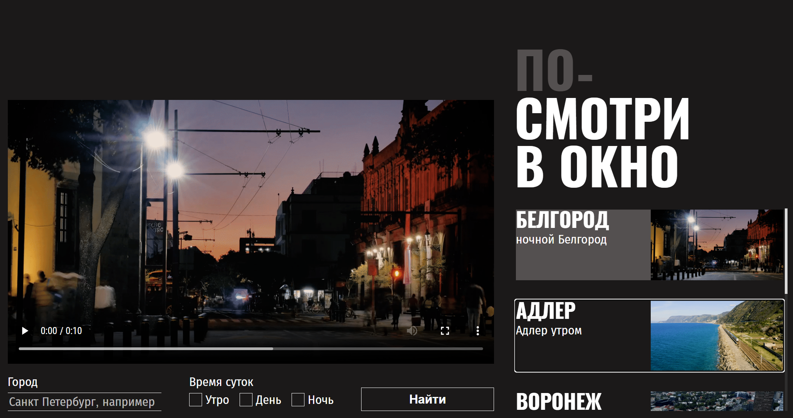

# Проект "Посмотри в окно"

---
> Интерактивное веб-приложение для просмотра и поиска атмосферных видео с возможностью фильтрации и подгрузки роликов по заданным параметрам (город и время суток). В рамках проекта выполнена полная CSS-стилизация интерфейса по макету: настроена сетка на Flexbox, оформлены карточки видео, форма поиска, кастомные элементы управления и состояния прелоадеров.

---


---

## 🚀 Функциональность интерфейса

* **Видеоплеер:** Отображение видеоролика в главном блоке с автоматическим обновлением контента при выборе карточки из списка.
* **Поиск и фильтрация:** Стилизованная форма поиска роликов по городу и времени суток с кастомными элементами управления.
* **Лента карточек:** Список с превью видеороликов и их описанием на базе Flexbox, дополненный кнопкой для подгрузки контента.
* **Обработка состояний:** Визуальное оформление различных состояний интерфейса, включая прелоадеры загрузки и экран ошибки.

---

## Установка и запуск

1. **Клонируйте репозиторий:**
```bash
git clone https://github.com/vasyausov693-cell/posmotri-v-okno-fd.git
```

2. **Перейдите в папку с проектом:**
```bash
cd posmotri-v-okno-fd
```

3. **Запустите проект:**
* Откройте файл `index.html` двойным кликом в браузере.
* *Или* запустите через локальный сервер (например, расширение **Live Server** в VS Code).

---

## Ссылка на демо

Посмотреть проект вживую: [Посмотри в окно](https://vasyausov693-cell.github.io/posmotri-v-okno-fd/)

---

## Автор

**Усов Василий** — [GitHub-аккаунт](https://github.com/vasyausov693-cell)